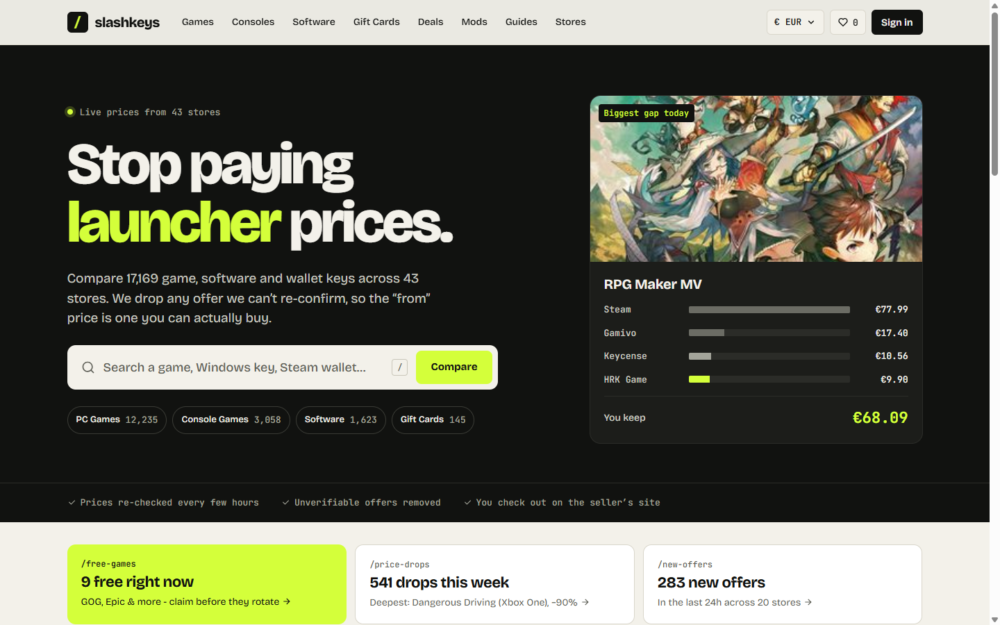

# SlashKeys

**Game, software and gift card key price comparison that shows only prices it can still confirm.**

[slashkeys.com](https://slashkeys.com) · [Case study](https://agicad.com/portfolio/slashkeys/)

> The source code is private. This repository documents the product and how it is built.

## The problem

Key sellers change page structures, regional availability and price display rules all the time, and many of them defend against bots. Scraping was not the hard part. The hard part was being honest about confidence: a comparison site that shows a price it can no longer verify is worse than one that shows nothing.

## How it's built

- **Three-state availability.** A stock integer that had come to mean three different things was replaced with three explicit states: available, unavailable and unknown. The change went out through an expand/contract migration across every write site.
- **Typed failures and per-seller circuit breakers.** Failures are classified as blocked, no HTML, unsupported or transient. A seller blocking the scraper is never mistaken for a real price change.
- **No starvation in URL resolution.** Each offer stores its last attempt and cohorts rotate, so one scheduled run can't keep reselecting the same rows.
- **Affiliate links kept apart from the data.** Affiliate metadata is stored per seller. The outbound click service falls back to the seller's normal URL until an approval exists, so monetisation never changes what users see.
- **Domain model in the repo.** A glossary and numbered ADRs define terms like displayable and purchasable offer scopes, reference offer and grace margin.
- **Contract tests.** These check that the SQL scope and the in-memory scope agree. They caught a product card that had reimplemented the display rule inline.
- **Performance.** Immutable cache headers on hashed assets, WebP served through content negotiation, self-hosted variable fonts, LCP preloads, and a move from Apache prefork to MPM event for HTTP/2.

## Stack

PHP 8, Laravel, Blade, Alpine.js, Tailwind CSS, Vite, MySQL, Playwright, Apache.

## Author

Built and run by [Toni Ilić](https://github.com/toniilic). I take on side projects through [AgiCAD](https://agicad.com).
